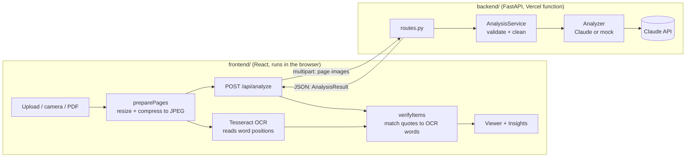
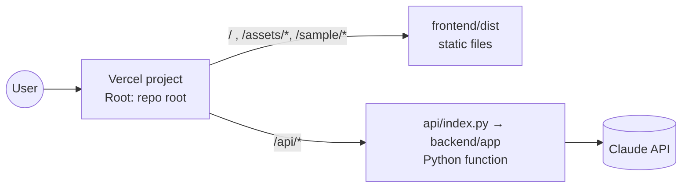
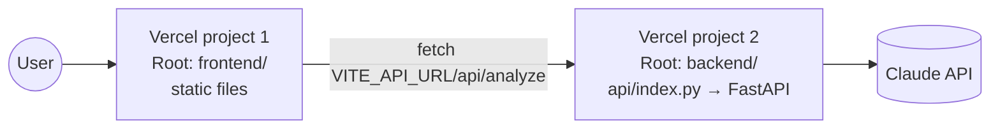

# How BriefVerstehen works

This document follows one letter from the user's camera to the screen. It
explains what each part does and why it was built that way. For setup
commands, see [README.md](README.md).

---

## 1. The big picture



There are two independent programs:

| | backend/ | frontend/ |
|---|---|---|
| Language | Python 3.12 | TypeScript |
| Framework | FastAPI | React + Vite |
| Job | Turn page images into a structured analysis | Collect pages, show results, verify them |
| State | None (stateless) | In memory in the browser tab only |
| Deployed as | Vercel serverless Python function | Static site on Vercel |

They share only the HTTP API. The shape of the JSON is defined once in
`backend/app/schemas/analysis.py` and mirrored in `frontend/src/api/types.ts`.

---

## 2. Step by step: one letter's journey

### Step 1 — The user adds pages (frontend)

`frontend/src/features/upload/UploadPanel.tsx` offers three ways in:

- **Take photo**: a file input with `capture="environment"` opens the phone's rear camera.
- **Choose files**: images or PDFs, several at once, or drag and drop.
- **Try a sample fine notice**: loads `public/sample/bussgeldbescheid.png`.

Pages appear as thumbnails that can be reordered or removed before analysis.

### Step 2 — Pages are normalised in the browser

`features/upload/preparePages.ts` converts everything into JPEG images:

- **Photos** are decoded with `createImageBitmap(..., { imageOrientation: "from-image" })`,
  so phone photos come out upright. They are scaled to at most 2000 px on the long edge
  and encoded as JPEG at quality 0.85.
- **PDFs** are rendered page by page with pdf.js. It is loaded only when a PDF is
  actually uploaded, because it is large.
- `fitToBudget` re-encodes the pages smaller (1600 → 1400 → 1200 px, lower quality)
  until the whole upload fits under the server's limit (4.4 MB). Vercel rejects
  request bodies over 4.5 MB.

Why on the client? The backend then only ever receives one kind of input
(images), uploads stay small, and no PDF or image libraries are needed in the
serverless function.

### Step 3 — Two things start at the same time

When the user presses **Translate & explain**, `features/analysis/useAnalysis.ts`
starts two jobs in parallel:

1. **The AI request:** `POST /api/analyze` with the page images (multipart form),
   the target language and the profile id.
2. **Local OCR:** Tesseract.js reads every page in the browser and records each
   word and its position. Its result is used only in step 7.

Running them in parallel means the OCR is usually finished by the time the AI
answers, so verification adds no visible waiting time.

### Step 4 — The backend validates the request

`backend/app/api/routes.py` receives the files and hands them to
`backend/app/services/analysis_service.py`, which:

- rejects empty uploads, more than `MAX_PAGES` pages, or more than `MAX_TOTAL_UPLOAD_BYTES`;
- checks each file's **magic bytes** (not its file name) to confirm it is JPEG, PNG,
  WebP or GIF, and rejects anything else with HTTP 415;
- looks up the **profile**, which describes the use case (see section 4).

### Step 5 — Claude reads the letter

`backend/app/analyzers/claude.py` sends a single request to Claude:

- **System prompt** = generic instructions (`analyzers/prompts.py`) + the profile's
  domain instructions (`profiles/german_letter.py`).
- **User message** = "Page 0:", image, "Page 1:", image, … and the target language.
- **Structured outputs**: `output_config.format` carries a JSON Schema generated
  from the Pydantic `AnalysisResult` model. The API guarantees the reply matches
  that schema, so there is no fragile JSON parsing of free text.
- **Streaming**: a multi-page translation can be long, so `max_tokens` is 32 000.
  The SDK requires streaming at that size. The stream is simply collected to the
  end; nothing is shown to the user until it is complete.
- **Effort**: `CLAUDE_EFFORT` (default `medium`) trades speed and cost against thoroughness.
- **Refusal fallback**: `fallbacks: "default"` lets the API retry on a recommended
  fallback model if a safety classifier declines a request.

The response is checked before it is used:

| Claude outcome | What the user sees |
|---|---|
| `stop_reason = refusal` | 422 "The AI declined to analyse this document." |
| `stop_reason = max_tokens` (answer cut off) | 413 "Too long… try fewer pages." |
| Output fails schema validation | 502 "Unreadable answer, please retry." |
| Rate limit / network / auth error | 429 / 504 / 500 with a plain message |

All of these are `AnalyzerError`s. `main.py` turns them into
`{"detail": "..."}` JSON, which the frontend shows in a red banner.

### Step 6 — The backend cleans the answer

Back in `AnalysisService`, `_sanitize` clamps every page index to the pages that
exist and every bounding box into 0–1000, with corners in the right order. A
slightly wrong coordinate from the model can therefore never break the UI.

### Step 7 — The browser verifies the answer

This is the trust feature. `features/ocr/verifyHighlights.ts` does the following
for every key item:

1. Splits the item's `source_quote` (the exact German text the model says it read)
   into normalised words: lower case, no punctuation.
2. Slides a window over the OCR words of that page and scores each position by
   word similarity. Levenshtein similarity is used, so OCR mistakes such as
   `0`/`O` still match.
3. Subtracts a small penalty for distance from the model's `bbox`. If a phrase
   appears twice, this picks the occurrence the model meant.
4. If the best text score is at least 0.7, the quote is **verified**. The
   highlight snaps to the real word boxes, drawn as one rectangle per text line,
   so quotes that wrap look right.
5. Otherwise the item keeps the model's own box and is drawn as an
   **approximate** dashed outline.

The cards show **✓ found on page** or **≈ approximate spot**. If OCR fails
entirely (for example, the CDN download is blocked), the results still show,
just without these badges.

### Step 8 — The results screen

- `features/viewer/DocumentViewer.tsx` draws each page photo and places absolutely
  positioned boxes over it, using percentages (`bbox / 10`). They scale with the
  image at any screen size. Three modes:
  - **Highlights**: coloured, numbered boxes on the key facts. Hovering a paragraph shows its translation.
  - **Translated**: every paragraph is covered with its translation. `FitText` shrinks
    the font until the text fits the paragraph's box.
  - **Original**: the plain photo.
- `features/insights/InsightsPanel.tsx` shows the summary, the "what to do" steps,
  key-item cards sorted by importance (each with number, kind, value, explanation,
  original quote and verification badge), and the full side-by-side translation.
- Clicking a card scrolls the viewer to its highlight and makes it pulse. Clicking
  a highlight selects its card.
- `features/calendar/ics.ts` turns every item with an ISO `date` into an all-day
  calendar event with reminders 3 days and 1 day before. The file is built in the
  browser; no server is involved.

---

## 3. The data contract

Everything the AI produces fits this shape (abridged):

```json
{
  "document_type": "Fine notice for speeding (Bußgeldbescheid)",
  "sender": "City of Musterstadt, Public Order Office",
  "source_language": "German",
  "target_language": "English",
  "summary": "The city says you drove 18 km/h too fast … Pay by 2 November 2026 …",
  "action_steps": ["Check the date…", "Transfer EUR 98.50 …"],
  "key_items": [
    {
      "id": "k1",
      "kind": "deadline",
      "importance": "high",
      "label": "Payment deadline",
      "value": "02.11.2026",
      "explanation": "The money must reach the city's account by this date.",
      "date": "2026-11-02",
      "amount": null,
      "currency": null,
      "page": 0,
      "bbox": { "x0": 471, "y0": 552, "x1": 715, "y1": 574 },
      "source_quote": "bis spätestens 02.11.2026"
    }
  ],
  "blocks": [
    {
      "id": "p0-b7",
      "page": 0,
      "bbox": { "x0": 105, "y0": 555, "x1": 840, "y1": 617 },
      "original": "Bitte überweisen Sie den Gesamtbetrag …",
      "translation": "Please transfer the total amount …"
    }
  ],
  "confidence_note": null
}
```

**Coordinates:** `bbox` values are integers in thousandths of the page.
`(0, 0)` is the top-left corner and `(1000, 1000)` is the bottom-right corner.
They don't depend on image resolution, which is why the browser can draw them
over a differently sized copy of the image.

**Key-item kinds:** `deadline`, `payment`, `appointment`, `reference`, `contact`,
`consequence`, `document_required`, `other`. Each has an icon and colour in
`frontend/src/lib/kinds.ts`.

**Changing the contract:** edit `backend/app/schemas/analysis.py` and
`frontend/src/api/types.ts` together. The JSON Schema sent to Claude is generated
from the Pydantic model automatically, so the AI immediately starts producing
the new fields.

---

## 4. Backend internals

```
backend/app/
├── main.py              create_app(): CORS, error handler, router
├── config.py            Settings from environment variables
├── api/routes.py        GET /api/health, GET /api/meta, POST /api/analyze
├── services/
│   └── analysis_service.py   validation → analyzer → sanitising
├── analyzers/           HOW to analyse (swappable)
│   ├── base.py          Analyzer protocol, PageImage, AnalysisRequest, AnalyzerError
│   ├── claude.py        Claude implementation
│   ├── mock.py          returns fixtures/sample_result.json
│   ├── prompts.py       generic instructions shared by all profiles
│   └── __init__.py      create_analyzer() factory
├── profiles/            WHAT to look for (domain knowledge)
│   ├── base.py          Profile dataclass
│   └── german_letter.py Fristen, Bußgeld, Aktenzeichen, Einspruch, …
├── schemas/analysis.py  the data contract
└── fixtures/            sample letter image + its exact analysis
```

The layers have one job each:

- **Routes** only deal with HTTP: parsing the form and returning JSON.
- **Service** owns rules that apply whatever AI is used: limits, file types, clean-up.
- **Analyzer** only talks to a model. Adding OpenAI, Gemini or a classic OCR +
  translation pipeline means one new class plus one line in `create_analyzer`.
- **Profile** carries the domain knowledge. A different hackathon problem
  (rental contracts, medical letters, school notices, another language) is a new
  profile file, usually with no other backend change.

`GET /api/meta` tells the frontend which analyzer is active, which profiles and
target languages exist, and the upload limits. The UI configures itself from it
and shows a "Demo mode" banner when the mock analyzer is running.

### Configuration (`backend/.env`)

| Variable | Default | Purpose |
|---|---|---|
| `ANTHROPIC_API_KEY` | — | Enables the Claude analyzer |
| `ANALYZER` | `claude` if a key is set, else `mock` | Force one analyzer |
| `CLAUDE_MODEL` | `claude-opus-5-5` | Model id |
| `CLAUDE_EFFORT` | `medium` | `low` is faster and cheaper, `high` more thorough |
| `DEFAULT_PROFILE` | `german_letter` | Profile used when the client sends none |
| `MAX_PAGES` | `6` | Pages per document |
| `MAX_TOTAL_UPLOAD_BYTES` | `4400000` | Must stay under Vercel's 4.5 MB body limit |
| `CORS_ORIGINS` | `http://localhost:5173` | Comma-separated frontend URLs allowed to call the API |

### Mock mode

Without an API key, `MockAnalyzer` returns `fixtures/sample_result.json` for
any upload. That fixture is generated by `scripts/make_sample.py`, which draws
the sample letter itself and therefore knows the exact pixel position of every
word. The mock highlights are pixel-perfect and the OCR verification passes,
which makes mock mode a realistic test bed for all frontend work.

### Tests

`backend/tests/` covers the API (health, meta, a full analysis in mock mode,
rejected file types, page limits) and the Claude analyzer. The analyzer tests
use a **fake HTTP transport**: they check the exact request sent to Claude
(model, schema, effort, fallback header, one image per page) and the error
mapping (refusal, truncation, rate limit) without network access or a key.

---

## 5. Frontend internals

```
frontend/src/
├── main.tsx, App.tsx, styles.css
├── api/
│   ├── types.ts         mirror of the backend contract
│   └── client.ts        fetchMeta(), analyzeDocument(); VITE_API_URL support
├── lib/kinds.ts         icons/colours per kind, date helpers
└── features/
    ├── analysis/useAnalysis.ts   ALL state + the pipeline (steps 2, 3, 7)
    ├── upload/                   UploadPanel + preparePages
    ├── ocr/verifyHighlights.ts   Tesseract + quote matching
    ├── viewer/                   DocumentViewer + FitText
    ├── insights/InsightsPanel.tsx
    └── calendar/ics.ts
```

- **One hook owns the logic.** `useAnalysis` holds pages, status, errors, the
  response and verification results. Components only display props and call
  callbacks, so UI work and pipeline work don't collide.
- **Feature folders** map to people: each folder can be changed without touching the others.
- **Where the API is:** `client.ts` uses `VITE_API_URL` when set (production, where
  the backend has its own domain) and same-origin `/api` otherwise. In development,
  `vite.config.ts` proxies `/api` to `http://127.0.0.1:8000`.
- **Theming:** colours are CSS variables with a dark-mode variant. Highlight colours
  stay fixed because they are always drawn on a white page.
- **Right-to-left languages:** translated text uses `dir="auto"`, so Arabic and Persian display correctly.

---

## 6. Deployment

There are two ways to deploy, and both configurations live in the repo side by side.

### Option A — one project from the repo root



Importing the repo uses the **root** `vercel.json`:

- `installCommand` / `buildCommand` install and build `frontend/`; `outputDirectory` is `frontend/dist`.
- `api/index.py` (repo root) is a 5-line shim that puts `backend/` on the import path
  and exposes `app.main:app`. `includeFiles` bundles `backend/app/**` with it.
- Vercel installs the root `requirements.txt` for the function. It must list the
  same packages as `backend/requirements.txt`, and `tests/test_vercel_entrypoints.py`
  fails if they drift apart.
- `/api/(.*)` is rewritten to the function; everything else is the static frontend.
- Frontend and API share one domain, so the frontend's default same-origin `/api`
  calls just work and no CORS setup is needed. Only `ANTHROPIC_API_KEY` must be set.
- The root `.vercelignore` keeps virtualenvs, `node_modules`, tests and scripts out of the upload.

#### Step by step: deploy option A

1. **Sign in.** Go to [vercel.com](https://vercel.com) → *Continue with GitHub*, using the
   account that owns the repository. The free Hobby plan is enough.
2. **Import.** *Add New… → Project* → pick the repository → *Import*. If it isn't
   listed, click *Adjust GitHub App Permissions* and grant access to it.
3. **Configure.** Change as little as possible:
   - *Project Name*: e.g. `briefverstehen`, which gives `https://briefverstehen.vercel.app`.
   - *Framework Preset*: leave as detected, or *Other*.
   - *Root Directory*: leave at `./` (the repo root). Don't choose `backend` or `frontend`.
   - *Build and Output Settings*: leave untouched; the root `vercel.json` sets them.
   - *Environment Variables*: add `ANTHROPIC_API_KEY` = your key. Optional:
     `CLAUDE_EFFORT` (`low` / `medium` / `high`), `MAX_PAGES`.
4. **Deploy.** Click *Deploy*. The build takes about 1–2 minutes.
5. **Check.**
   - `https://<project>.vercel.app/api/health` returns `{"status":"ok"}`.
   - `https://<project>.vercel.app/api/meta` starts with `"analyzer":"claude"`. If it
     says `"mock"`, the key is missing.
   - The home page shows no yellow "Demo mode" banner, and uploading a letter returns a real analysis.

After that, every push to `main` redeploys production automatically, and every
pull request gets its own preview URL.

**Troubleshooting**

| Symptom | Fix |
|---|---|
| `/api/meta` says `"analyzer":"mock"` | *Settings → Environment Variables*: set `ANTHROPIC_API_KEY` for Production, then *Deployments → ⋯ → Redeploy* (environment variables only apply to new deployments) |
| Build fails mentioning `maxDuration` | Your plan allows less time: lower `"maxDuration"` in the root `vercel.json` (e.g. to `60`) and push |
| Site loads but `/api/...` returns 404 | Root Directory was changed; set it back to the repo root in *Settings → General* and redeploy |
| Analysis ends with "took too long" (504) | Set `CLAUDE_EFFORT=low` or upload fewer pages |
| "Upload is too large" (413) | Pages are compressed automatically; use fewer pages or lower-resolution photos |
| Anything else | Open the deployment → *Logs* / *Build Logs* and read the first red line |

### Option B — two projects



#### Files used by option B

| File | Purpose |
|---|---|
| `backend/vercel.json` | Declares `api/index.py` as a Python serverless function (120 s `maxDuration`, bundles `app/**`, leaves out tests and scripts) and rewrites **every** path to it, so FastAPI handles all routing. |
| `backend/api/index.py` | The function entry point. It puts `backend/` on the import path and exposes `app` from `app.main`, which Vercel serves as an ASGI app. |
| `backend/requirements.txt` | Vercel installs these Python packages for the function (dev-only tools live in `requirements-dev.txt`). |
| `backend/.vercelignore` | Keeps `.venv`, caches, `.env`, tests and scripts out of the upload. |
| `frontend/vercel.json` | Vite preset: runs `npm run build` and serves `dist/` as static files. |
| `frontend/.vercelignore` | Keeps `node_modules`, `dist` and local env files out of the upload. |

#### Settings for option B

| Project | Root Directory | Environment variables |
|---|---|---|
| Backend | `backend` | `ANTHROPIC_API_KEY`, `CORS_ORIGINS` = frontend URL; optionally `CLAUDE_EFFORT`, `MAX_PAGES` |
| Frontend | `frontend` | `VITE_API_URL` = backend URL (no trailing slash) |

With the Vercel CLI the same thing works from each folder:
`cd backend && vercel --prod`, then `cd frontend && vercel --prod`.

#### Notes for option B

- Because the two projects have different domains, the browser makes
  cross-origin requests. The backend's `CORS_ORIGINS` must include the
  frontend's URL, and the frontend's `VITE_API_URL` must point at the backend.
  `VITE_API_URL` is baked in at build time, so redeploy the frontend after
  changing it.

---

## 7. Privacy and limits

- Nothing is stored. Images go to the backend, are forwarded to Claude, and are
  discarded when the request ends. Results live only in the browser tab.
- Tesseract downloads its language data from a CDN the first time it is used.
- HEIC photos (iPhone default) decode only in Safari; other browsers need JPEG/PNG.
- A 6-page letter can take a while. If you hit the 120 s limit, lower
  `CLAUDE_EFFORT` or `MAX_PAGES`.
- Model bounding boxes are approximate; OCR verification fixes most of them, but
  very skewed or handwritten pages may stay "approximate".

---

## 8. Extending it for the main hackathon

| You want to… | Change |
|---|---|
| Handle a different document type or domain | Add `backend/app/profiles/<name>.py` and register it in `profiles/__init__.py` |
| Extract new fields | `schemas/analysis.py` + `frontend/src/api/types.ts`, then render them in `InsightsPanel` |
| Add a key-item category | `KeyItemKind` on both sides + `frontend/src/lib/kinds.ts` |
| Use another AI provider | New class in `backend/app/analyzers/`, one line in `create_analyzer` |
| Add a feature (draft a reply, find the right office, …) | New route + service in the backend; new `frontend/src/features/<name>/` folder |
| Support another source language | The profile's `source_language`; add its Tesseract code in `verifyHighlights.ts` |
